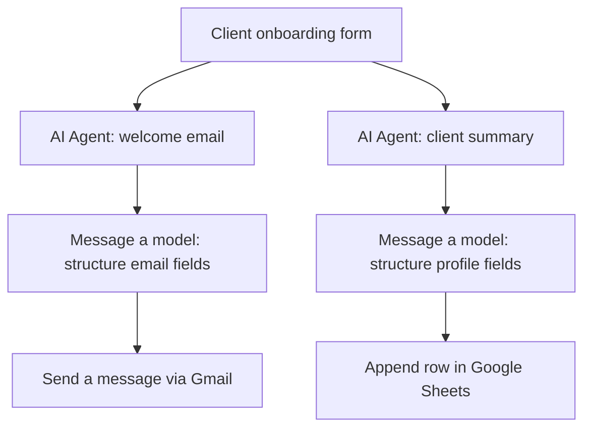

# Client Onboarding

An n8n workflow that collects new-client details, generates a personalized welcome email with AI, sends it through Gmail, and creates a concise client profile summary in Google Sheets.

## Workflow at a glance

## What it does

1. **Collects client details:** The n8n form asks for the client's name, email, industry, three-month goals, and any additional context.
2. **Creates a welcome email:** An AI Agent uses the client's industry and goals to draft a concise, friendly, professional welcome message.
3. **Structures the email:** A model formats the generated content into subject, body, and recipient email fields.
4. **Sends the email:** Gmail sends the welcome message to the submitted email address.
5. **Summarizes the client:** A second AI Agent creates a short profile summary using the submitted information.
6. **Stores the summary:** A model structures the name, email, and summary fields, and Google Sheets appends them as a new row.

## Nodes and integrations

- n8n Form Trigger
- AI Agent and OpenAI Chat Model
- OpenAI model node for structured output
- Gmail (send email)
- Google Sheets (append row)

## Configuration required after import

- Reconnect OpenAI, Gmail, and Google Sheets credentials in n8n.
- Replace `REPLACE_WITH_YOUR_GOOGLE_SHEET_ID` with your own spreadsheet ID.
- Configure the Google Sheet tab and ensure it has columns matching `Name `, `Email`, and `Summary` (note the trailing space in `Name `).
- Review the welcome-email prompt and replace the sample sign-off/company details with your own approved sender identity.
- Confirm the form field labels and email mapping.
- Test with dummy client details and a test inbox before using real customer data.

## Security and operational notes

- Credentials, credential IDs/names, webhook IDs, workflow-instance metadata, and the original spreadsheet identifier are omitted from this portfolio export.
- Store credentials in n8n's credential manager; do not place API keys or OAuth tokens directly in workflow JSON.
- Review generated email content and verify the recipient mapping before enabling live sending.
- Collect only client information needed for onboarding and protect the resulting spreadsheet with appropriate access controls.

## Notes

This sanitized export is a template, not a ready-connected workflow. Reconnect credentials and configure your own spreadsheet before running it.
