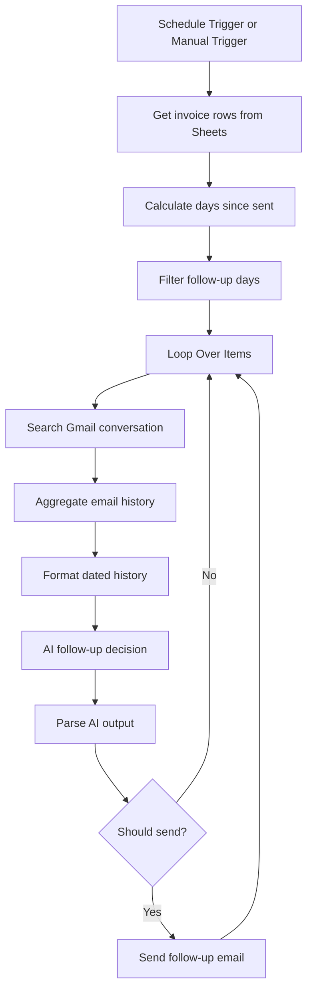

# Invoice Follow-up

An AI-assisted invoice reminder workflow. It reads invoice rows from Google Sheets, calculates how long each invoice has been outstanding, checks Gmail conversation history, and uses an AI model to decide whether a staged follow-up should be sent.

## Workflow at a glance

## What it does

1. **Starts manually or on a schedule:** The workflow includes both a manual trigger and a schedule trigger.
2. **Reads invoice records:** Google Sheets provides invoice rows, including client, email, invoice ID, amount, service description, date sent, and payment status.
3. **Calculates invoice age:** An Edit Fields node computes days since the invoice was sent.
4. **Selects follow-up windows:** The filter checks configured day milestones (9, 18, 27, 36, and 45 days).
5. **Checks email history:** Gmail searches messages to or from the client, and the workflow aggregates message text and dates.
6. **Makes an AI decision:** The prompt selects a reminder stage and checks for recent correspondence, payment, disputes, or a request not to be contacted. It returns a verdict, reason, subject, and email body.
7. **Sends conditionally:** The `Should Send?` node controls whether Gmail sends the follow-up.

## Follow-up stages in the prompt

- Stage 1: Friendly reminder
- Stage 2: Polite follow-up
- Stage 3: Action required
- Stage 4: Final notice
- Stage 5: Immediate action required

## Nodes and integrations

- Manual Trigger and Schedule Trigger
- Google Sheets (read invoice records)
- Edit Fields (date calculation and email/name normalization)
- Filter and Limit (testing; disabled in the export)
- Loop Over Items
- Gmail (retrieve conversation history and send follow-up)
- Aggregate
- OpenAI model node
- Edit Fields (parse AI output)
- IF node (`Should Send?`)

## Configuration required after import

- Reconnect Google Sheets, Gmail, and OpenAI credentials.
- Replace the Google Sheets ID placeholder and verify the source tab and expected column names.
- Confirm the date format and timezone used by `Date Sent` and the schedule trigger.
- Review the milestone days and the stage mapping in the AI prompt.
- Verify Gmail search behavior and message-history coverage.
- Confirm the `Should Send?` condition and test the no-send branch.
- Review all reminder templates, sender identity, and any legal/collections language before sending.
- Test with dummy invoices and a test mailbox first.

## Safety and operational notes

- The workflow's AI verdict is an automation decision, not proof of payment status or legal advice.
- Verify payment status against the authoritative accounting system before sending reminders.
- The later-stage templates include escalation language; review it for contractual and legal accuracy before enabling automatic sending.
- A Gmail search limited to recent message results may not represent the complete client relationship.
- The export includes a disabled testing Limit node.

## Notes

The export contains 14 nodes. Credentials, webhook IDs, pinned data, workflow-instance metadata, and the original spreadsheet identifier have been removed from this portfolio copy.
