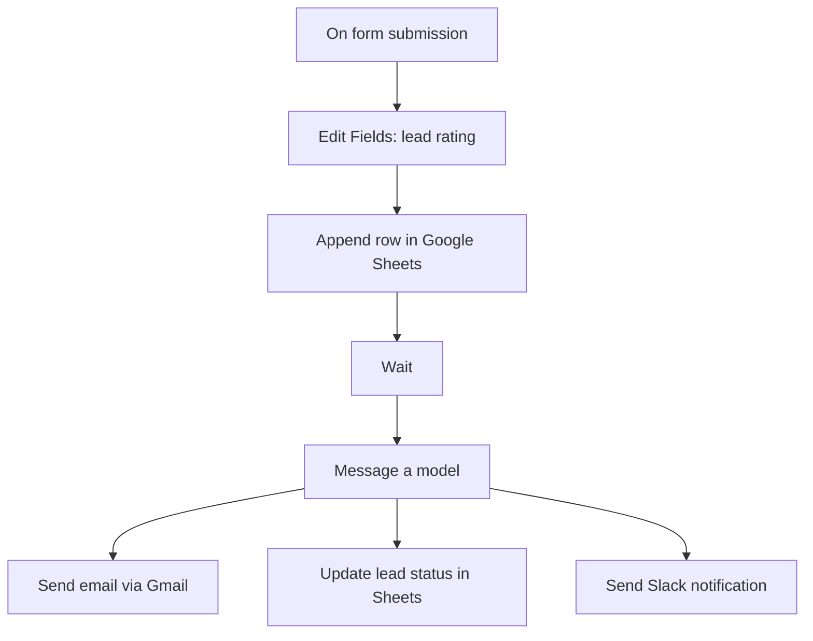

# Lead Response

An n8n lead-intake and response workflow for RG YTP Solutions. It collects prospect requirements, assigns a budget-based lead rating, records the lead, generates a tailored email with an AI model, and sends follow-up notifications.

## Workflow at a glance

## What it does

1. **Captures a lead:** The n8n form requests name, contact number, email, business problem, and budget.
2. **Rates the lead:** The `Edit Fields` node maps the submitted budget to `Needs Review`, `Normal`, `Good`, or `Great (Hot Lead)` using the thresholds defined in the workflow.
3. **Stores the submission:** Google Sheets appends the lead information and rating.
4. **Generates a personalized response:** The AI prompt asks for a concise, professional email acknowledging the prospect's specific business problem and suggesting a suitable next step. It also requests structured JSON output.
5. **Sends and records:** Gmail sends the generated subject/body, a Sheets node updates the lead status, and Slack sends a notification.

## Nodes and integrations

- n8n Form Trigger
- Edit Fields (budget-based lead rating)
- Google Sheets (append and update)
- Wait
- OpenAI model node
- Gmail (send email)
- Slack (notification)

## Configuration required after import

- Reconnect Google Sheets, Gmail, OpenAI, and Slack credentials in n8n.
- Replace the Google Sheets document ID placeholder with your own spreadsheet ID.
- Confirm the target spreadsheet tabs and columns (`Name`, `Contact`, `Email`, `Desc`, `Budget`, `Lead Rating`, and status fields).
- Review the form labels and the budget-rating thresholds.
- Verify the Slack destination and Gmail sending account.
- Check the wait-node behavior and all outgoing message mappings.

## Testing checklist

- Submit a test lead with each budget range, including a blank or malformed budget.
- Confirm the lead row and rating are written correctly.
- Inspect the AI JSON output for valid subject and body fields.
- Verify the email recipient and message using a test inbox.
- Confirm the status update and Slack notification.
- Do not test with real personal data until privacy and access controls are in place.

## Notes

The export contains an 8-node workflow. Credentials, webhook IDs, pinned data, workflow-instance metadata, and the original spreadsheet identifier have been removed from this portfolio copy. Reconfigure these before execution.
