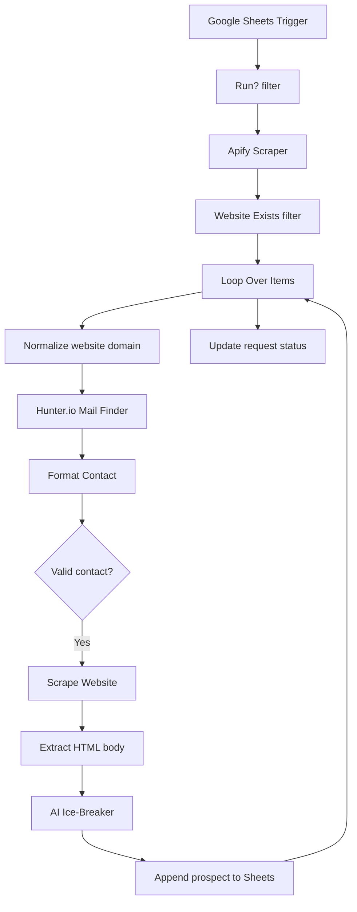

# Nimzlot Proto (Lead Gen and Personalized outreach system for Nimzlot)

A prospect-discovery and enrichment workflow. It uses a Google Sheets row as a run request, searches for businesses using Apify, checks for websites, enriches contact details with Hunter.io, scrapes company websites, and asks an AI model to produce a personalized cold-email icebreaker.

## Workflow at a glance

## What it does

1. **Starts from a spreadsheet update:** The Google Sheets Trigger watches for row updates. A filter allows processing only when `Status` equals `Run`.
2. **Discovers businesses:** The Apify actor receives the company type, location, and requested result count from the sheet row.
3. **Checks for websites:** Results without a website are filtered out.
4. **Processes prospects:** The loop iterates through the discovered businesses.
5. **Finds contact information:** The workflow normalizes the website domain and queries Hunter.io for a contact.
6. **Validates and enriches:** It formats the contact's name, email, and position, then checks that name and email are present.
7. **Creates an icebreaker:** The website is fetched and its body text extracted. An AI prompt uses the contact profile, company name, and website text to generate a short personalized icebreaker in JSON.
8. **Stores results:** The prospect details and icebreaker are appended to the `Emails` sheet. The request row is updated to `Done`.

## Nodes and integrations

- Google Sheets Trigger
- Filter nodes (`Run!`, `Website Exists`)
- Apify actor node
- Loop Over Items
- Edit Fields / Format Contact
- Hunter.io Mail Finder
- IF node (`Valid?`)
- HTTP Request (`Scrape Website`)
- HTML extraction
- OpenAI model node (`Ice-Breaker`)
- Google Sheets (append results and update request status)

## Configuration required after import

- Reconnect Google Sheets, Apify, Hunter.io, and OpenAI credentials in n8n.
- Replace the spreadsheet ID placeholder and confirm the `Roles` and `Emails` tabs and their column names.
- Confirm the Apify actor ID and account permissions.
- Review Apify search settings, result limits, and usage costs.
- Reconnect Hunter.io and confirm its plan/rate limits.
- Review the website scraping request and comply with each site's terms and robots policies.
- Review the AI prompt before using generated copy for outreach.

## Testing checklist

- Set a test row's status to `Run` and use a small result count.
- Confirm the scraper receives the expected company type and location.
- Check behavior for businesses with no website.
- Test contacts with missing names or email addresses.
- Verify scraped page text is passed into the AI node as intended.
- Confirm generated icebreakers and spreadsheet mappings.
- Confirm the input row is marked `Done` only at the intended point in the loop.

## Notes

The export contains 14 nodes. The original workflow uses website and contact enrichment; it does not demonstrate that every discovered business will have a valid contact or that generated icebreakers are verified. Credentials, webhook IDs, pinned data, workflow-instance metadata, and the original spreadsheet identifier have been removed from this portfolio copy.
